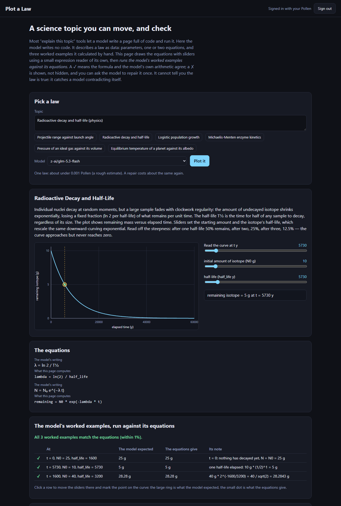
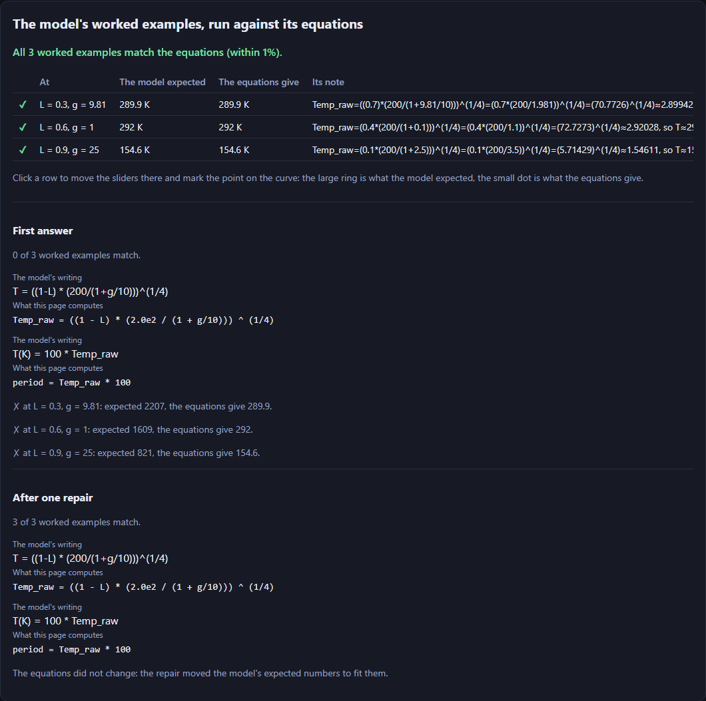

# Plot a Law

[](https://pollinations.ai/?ref=badge)

**Live:** https://tomdacatto.github.io/pollinations-plot-a-law/

Pollinations quest [#19181](https://github.com/pollinations/pollinations/issues/19181): an app that turns a science topic into an interactive visual explanation, built on Pollinations models and paid with the visitor's own Pollen.



## The idea: the model writes data, not code

Most explainers ask a model for a page of HTML and JavaScript and run it. Here the model writes no code. For a topic it returns one JSON object:

- a short explanation (at most 120 words),
- one to three parameters with units, ranges and defaults,
- one or two equations as expression strings, and the quantity to plot,
- **three worked examples it calculated by hand** (parameter values and the number it expects),
- the books or papers it knows the law from.

The page does the rest:

1. It reads the equations with its own small expression reader (`law.js`: numbers, `+ - * / ^`, brackets, `pi`, `e` and a short list of functions; no `eval`, no `Function`, unknown names and implicit multiplication are refused).
2. It draws the curve as SVG with a slider for every parameter and one to read the curve at any x.
3. **It runs the model's worked examples against the model's equations** and shows a ✓ or ✗ for each. Click a row and the sliders move there; a ring marks what the model expected and a dot what the equations give.
4. If any example fails, **Ask the model to fix it** sends the model its own answer and the failed points, once. The page shows the first answer and the repaired one side by side, and says when the equations did not change and only the expected numbers moved.

The equations are shown twice: as the model wrote them for a reader, and as the page actually computes them, so a mismatch between the two is visible.

## A real run

Signed in with my own Pollen on the live code (the app's own prompts and checks, `law.js` and `pollen.js`, called from a script): six topics (projectile range, radioactive decay, logistic growth, Michaelis-Menten kinetics, an ideal gas, a planet's equilibrium temperature) times four free models, one request each.

| Model | Usable answers | Worked examples that match | Answers with all 3 matching | Repairs that reached 3 of 3 |
|---|---|---|---|---|
| z-ai/glm-5.3-flash | 6 of 6 | 18 of 18 | 6 | none needed |
| deepseek/deepseek-v4.1-flash | 6 of 6 | 18 of 18 | 6 | none needed |
| minimax/minimax-m3.1-flash | 5 of 6 | 15 of 15 | 5 | none needed |
| openai/gpt-5.4-nano | 6 of 6 | 12 of 18 | 4 | 2 of 2 |
| **all** | **23 of 24** | **63 of 69** | **21** | **2 of 2** |

- The one unusable answer (minimax, radioactive decay) listed more than two equations, which the page refuses and shows with the reply.
- What the table does and does not say. The ✓ means the equations and the model's own hand arithmetic agree within 1%. **It is not a measure of whether the law is right.** I read the equations of the 23 usable answers: those from glm, deepseek and minimax are the textbook forms of these six laws. Those from gpt-5.4-nano are mostly not: for the planet and logistic topics it wrote equations in the wrong variables (`T = 278 * ((1 - L) / 0.7)^0.25 ...`, a `tHalf` and a `period`), titled the projectile law with a free-fall time (`sqrt(2 * L / g)`), and its repairs reached 3 of 3 by **changing the expected numbers to fit the same equations**. The page labels such a repair ("The equations did not change"), and the screenshot below is one.



- Two earlier runs of the same 24 requests, before the prompt and checks were changed. First: 21 usable, 57 of 63 examples matching, with a prompt whose format example was a projectile; `gpt-5.4-nano` copied that example's equation for two other topics, and its repairs then "passed" with the wrong law. The format example is now a pendulum, which is not one of the six topics. Second: 20 usable, 56 of 60 matching; names longer than 16 characters and equations that used one listed after them were refused. Names may now be 32 characters and the prompt says an equation can use only earlier ones.
- Median answer time 19 s, slowest 59 s. Every request has its own `seed`, because Pollinations serves identical requests from cache.

## Not verified

- **Whether a law is true.** The checks catch a model contradicting itself (formula against its own examples, or a wrong hand calculation), not a wrong law, and not a wrong law that is consistent with itself. The sources are named by the model; the page does not look them up and a model can name a book that does not say this.
- The six topics are textbook laws a small model knows well. Obscure topics were not run.
- One run per model and topic in the final table; rates move between runs (see the earlier runs above).
- Phones and browsers other than desktop Chrome. The sign-in redirect on the live address: the key was loaded into the page from a device-flow login for the run, and the live-page screenshots use that key.
- The sign-in sends the app's publishable App Key (`APP_KEY` in `config.js`, earnings off) as `client_id`; a real consent screen naming the app was not checked.
- The default models were chosen because they are free for every visitor (`paid_only` is false on `gen.pollinations.ai/v1/models`, checked 2026-11-12). Paid models stay in the list marked "paid"; one picked on free Pollen shows the 402 message for that request only.

## How it pays

There is no server and no key in this repository. The visitor signs in on enter.pollinations.ai ([Bring Your Own Pollen](https://github.com/pollinations/pollinations/blob/main/BRING_YOUR_OWN_POLLEN.md), fragment flow); the key comes back in the URL fragment, is removed from the address bar and is kept in `sessionStorage` for that tab only. The sign-in asks for a 0.3 Pollen budget and one day. Models and prices come live from `gen.pollinations.ai/text/models`, and the page shows a rough price before each law.

## Files

- `law.js`: the expression reader, the spec check, the worked-example check, the prompts (no DOM, no network)
- `plot.js`: the SVG plot; `app.js`, `ui.js`, `index.html`, `style.css`: the page
- `pollen.js`: sign-in and the chat call; `models.js`: the live model list; `config.js`: budget, App Key, default models

## Run and test

```bash
python -m http.server 8791   # any static server works
npm test                     # node --test, no dependencies
```

MIT licensed.
